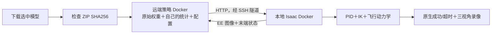

# 已完成训练模型的下载与重放

本页对应 **UAQuad 固定旋翼四旋翼＋机械臂、PressButton、PID**。模型已经完成完整训练预算和独立闭环测试，可以下载实际用于最终测试的权重。[实验视频](https://zipengdai.com/ambench/trained/)保留全部成功与失败；更多技术流程见 [uaquad.md](uaquad.md)，双容器配置见 [note.md](note.md)。

## 1. 下载的究竟是什么

| 模型 | 实际完成训练 | 下载的选中权重 | 独立最终测试 |
| --- | --- | --- | --- |
| ACT，ResNet18 | **40,000** 次 AdamW 更新 | step **40,000**，原始模型及成对 processor | **0/30**，全部超时 |
| Diffusion Policy，CLIP ViT-B/16＋完整 U-Net | **40 epochs / 46,480** 次 AdamW、EMA 更新 | **epoch 16 / 18,592** 次更新的 EMA | **30/30**，全部成功 |

DP 完成整条 40-epoch 训练链后，才按预先声明的 80 次选模试验和离线验证指标选中 epoch 16；不能把它写成“只训练了 16 epochs”，也不能把最后 epoch 40 冒充选中模型。最终 30 个 seeds 在锁定权重后才运行，不参与选模。ACT 的失败结果同样保留，完整训练预算并不保证任务成功。

canonical 源动作是绝对 8D 末端位姿与夹爪命令；ACT 内部学习局部相对轨迹，DP 内部使用位置、rotation6d、夹爪的 10D 表达。各自适配器负责归一化、相对坐标和绝对命令之间的转换，不能直接把网络原始输出送进控制器。

### 训练设置依据

参数依据 [AM-Bench 论文表 8、附录 B.2](https://arxiv.org/pdf/2609.00641v1) 和保存的解析配置；UAQuad 专属数据与 40k ACT 延长训练属于本分支的研究扩展。

| 设置 | ACT | Diffusion Policy |
| --- | --- | --- |
| 数据 | 本机型成功示范 80 条训练／20 条验证；20 Hz | 相同 episode 划分；20 Hz 轨迹、两个观察时刻 |
| 视觉初始化 | ImageNet ResNet18；EE 图像 384×384 | 预训练 CLIP ViT-B/16；EE 图像 224×224 |
| 动作序列 | chunk 16，执行前 8 个 | horizon 16；U-Net 通道 256/512/1024；DDIM 推理 16 步、训练扩散 50 步 |
| 优化 | AdamW，LR 1e-5，batch 8，KL 权重 10 | LR 3e-4；microbatch 8×梯度累积 8，名义 batch 64；每 epoch 尾窗口 49 个样本保留 |
| 预算与恢复 | 论文基线 20k，恢复优化器/RNG 后继续到实际 40k | 40 完整 epochs；实际 299 个 AdamW 状态、EMA 和 scheduler 计数均为 46,480 |

每个模型使用自己的训练集统计。ACT 恢复时重新建立 DataLoader，因此不宣称逐位等价于无中断 40k；完整预算也不等价于收敛。论文主学习成绩使用 FAHexa，本文结果不能作为原论文的完整复现。

这两个结果只覆盖一个机型、一个任务。它们没有证明十二任务能力上限、实机部署或 real2sim2real；OpenPI、OmniHexa 和 WipeWindow 的完整训练进展单独记录。

### 文件与校验

[打开模型 Release](https://github.com/superboySB/ambench/releases/tag/research-models-20261015-uaquad-pressbutton)，或直接下载：

| 附件 | 大小 | 内容 |
| --- | --- | --- |
| [DP 推理 ZIP](https://github.com/superboySB/ambench/releases/download/research-models-20261015-uaquad-pressbutton/uaquad-pressbutton-dp-ema-epoch016-selected-native-v1.zip) | 685,431,484 bytes | 原始 EMA `model.ckpt`、内嵌配置与训练集归一化、选中与完整预算、逐 tensor 来源 |
| [ACT 推理 ZIP](https://github.com/superboySB/ambench/releases/download/research-models-20261015-uaquad-pressbutton/uaquad-pressbutton-act40000-selected-native-v1.zip) | 206,416,684 bytes | 原始 `pretrained_model/`、配置、pre/post processor、归一化、数据与训练来源 |
| [模型清单](usage_assets/trained/models.json) | 小型 JSON | 两个 ZIP 的 SHA-256、模型身份与验证边界；[Release 同一份文件](https://github.com/superboySB/ambench/releases/download/research-models-20261015-uaquad-pressbutton/models.json) |

```text
DP ZIP SHA256
251ed9ea70b364153387409ec0bbba4d85b6c257881271dde42221db4041dce4

ACT ZIP SHA256
f64d0b7578731ef6a30aa2cb82b38de9d1942ea86464f34caf763754ec11d3b3
```

两个 ZIP 都保留选中模型原始字节，并逐成员核对 SHA。**这是推理包，不能恢复优化器训练**；完整 AdamW、EMA、scheduler、RNG 检查点仍保存在实验存储中。ZIP 内有独立 `USAGE.md`、`provenance.json` 与许可证。

2026-10-15 已不带认证重新下载该 Release 全部 **5 个附件、892,622,456 bytes**，核对完整 SHA；每个附件的匿名 Range、长度和文件签名也通过。[交付记录](usage_assets/trained/model_delivery.json)保存结果。CDN 实际返回 `application/octet-stream`，按 ZIP/JSON 文件内容使用。

## 2. 固定源码与环境



历史训练与评估的身份如下：

| 内容 | 固定提交 |
| --- | --- |
| ACT 训练、processor 与后端 | `472b096e72bad94bb5ef337dea50656d01c46791` |
| ACT 有效最终评估，包括 reset 相机重绘 | `38d2a3246506363617555fd26fa3d30988b23ff2` |
| DP 训练、推理与最终评估 | `875569d125c57a2d17818ec334d605407478cbdc` |

可用 `875569d` 准备共同重放源码：该版本的 ACT、远端后端和数据模块与 ACT 训练版本逐文件相同，仿真代码与 ACT 有效评估版本相同。使用独立 worktree，不切换正在被其他作业挂载的 checkout：

```bash
git worktree add --detach ../ambench-trained-replay 875569d125c57a2d17818ec334d605407478cbdc
```

在该 worktree 按 [note.md](note.md) 的双容器部署流程构建依赖、挂载这个源码并配置 SSH 隧道；容器和输出目录使用独立名称。下方命令沿用手册的 `ambench-sim-research` / `ambench-policy-research` 名称，已有其他实验时需要成套替换。宿主机和服务器本体不安装模型包。

本轮已验证原模型闭环、下载字节与源码身份；新机器的首次构建仍需完成相应 Docker、GPU 和资产检查。2026-10-15 的复测复用了已有镜像，不能当作已重新构建两张最终镜像。

## 3. 下载并放进远端策略容器

从仓库根目录执行。`trained-models-repeat01` 是新的输出名；重复试验时统一改名。先下载 DP：

```bash
mkdir -p outputs/trained-models-repeat01
curl --fail --location \
  --output outputs/trained-models-repeat01/dp.zip \
  https://github.com/superboySB/ambench/releases/download/research-models-20261015-uaquad-pressbutton/uaquad-pressbutton-dp-ema-epoch016-selected-native-v1.zip
echo '251ed9ea70b364153387409ec0bbba4d85b6c257881271dde42221db4041dce4  outputs/trained-models-repeat01/dp.zip' | sha256sum --check

ssh -p 22 tencent-86 'mkdir -p /diff/dzp_is_sb/ambench-research/outputs/trained-models-repeat01'
rsync --progress -e 'ssh -p 22' outputs/trained-models-repeat01/dp.zip \
  tencent-86:/diff/dzp_is_sb/ambench-research/outputs/trained-models-repeat01/
ssh -p 22 tencent-86 \
  'cd /diff/dzp_is_sb/ambench-research/outputs/trained-models-repeat01 && echo "251ed9ea70b364153387409ec0bbba4d85b6c257881271dde42221db4041dce4  dp.zip" | sha256sum --check'
ssh -p 22 tencent-86 \
  'docker exec ambench-policy-research true'
```

解压使用策略容器内已有 Python。以下检查拒绝覆盖已存在的解压目录：

```bash
ssh -p 22 tencent-86 \
  'docker exec ambench-policy-research sh -c "test ! -e /data/outputs/trained-models-repeat01/dp"'
ssh -p 22 tencent-86 \
  'docker exec ambench-policy-research /opt/venvs/act/bin/python -m zipfile -e /data/outputs/trained-models-repeat01/dp.zip /data/outputs/trained-models-repeat01/dp'
```

ACT 同理：下载上表 ACT ZIP，核对对应 SHA，传为 `act.zip`，解压到新的 `act/`。模型路径是 `act/pretrained_model/`；不要只取出 `model.safetensors`，其配套归一化和 processor 必须一起使用。

## 4. 启动与判定

下面复用最终测试使用的 **CPU 推理、seed 42**。先启动远端 DP 服务：

```bash
bash tools/research/start_policy.sh --cpu dp \
  /data/outputs/trained-models-repeat01/dp/model.ckpt
```

在一个终端保持 `bash tools/research/tunnel_policy.sh` 运行；另一个终端等待 `bash tools/research/wait_policy.sh dp 600` 成功，再执行本地仿真：

```bash
docker exec ambench-sim-research python -m ambench_learn.policies.dp.eval \
  --task PressButton-Am-UAQuad-Abs-PID-Direct-v0 \
  --num-envs 1 --num-rollouts 1 --seed 35001 --episode-length-s 20 \
  --remote-url http://127.0.0.1:8001 --save-video \
  --video-camera-names scene_camera base_camera ee_camera \
  --output-dir outputs/trained-models-repeat01/dp-replay-seed35001 \
  --headless --device cuda:0
```

`35001` 是新的重放 seed，不属于历史最终 30 次测试。ACT 使用 `start_policy.sh --cpu act /data/outputs/trained-models-repeat01/act/pretrained_model`，等待 `act` 后将 evaluator 模块改成 `ambench_learn.policies.act.eval`，同时换新的输出目录。

检查 `eval_summary.json` 的 `status`、rollout 数、`termination_reason`、真实步数、任务与 seed。`completed` 表示执行完成；原生 `success` 才是任务成功。模型使用 EE 相机，另外两路只负责录像；三路视角仍算一次试验。仿真为 120 Hz、策略目标 20 Hz、原生时限 20 秒、扰动关闭、reset 重绘 1 次。CPU 推理的墙钟耗时可能很长，不代表实机能达到 20 Hz。

## 5. 原始视频的完整性

ACT、DP 各 80 条选模加 30 条最终试次，共 **220 个 episodes、660 段原片**已完整逐帧 CPU 解码。检查覆盖 H.264/yuv420p、严格递增 PTS、同一 episode/任务/seed 绑定、三视角时长和原文件 SHA；没有重编码或重新挑选测试结果。

- [ACT 110 次／330 原片全帧记录](https://github.com/superboySB/ambench/releases/download/research-models-20261015-uaquad-pressbutton/act-110-original330-fullframe-decode.json)
- [DP 110 次／330 原片全帧记录](https://github.com/superboySB/ambench/releases/download/research-models-20261015-uaquad-pressbutton/dp-110-original330-fullframe-decode.json)
- [全部实验与三视角播放](https://zipengdai.com/ambench/trained/)

旧录像的编码和自动 reset 尾帧边界仍按 [usage.md](usage.md#本轮逐步复测2026-10-15) 标注；完整解码不会把这些历史边界变成“已经修复的原片”。模型 ZIP、原始 MP4、数据和 checkpoint 都通过外部存储提供，不加入 Git，也不依赖 Git LFS。
